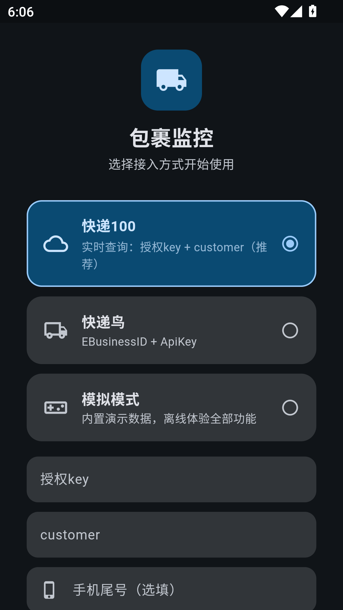
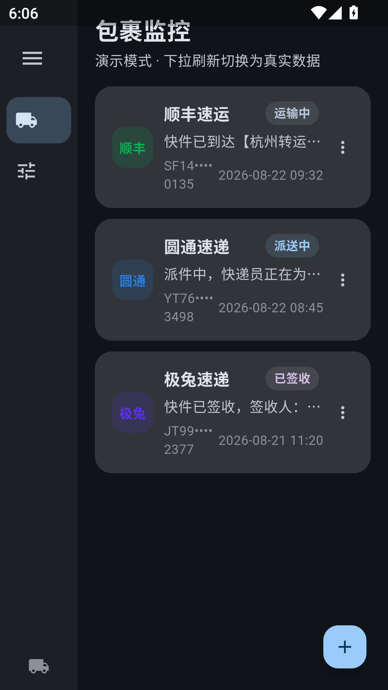
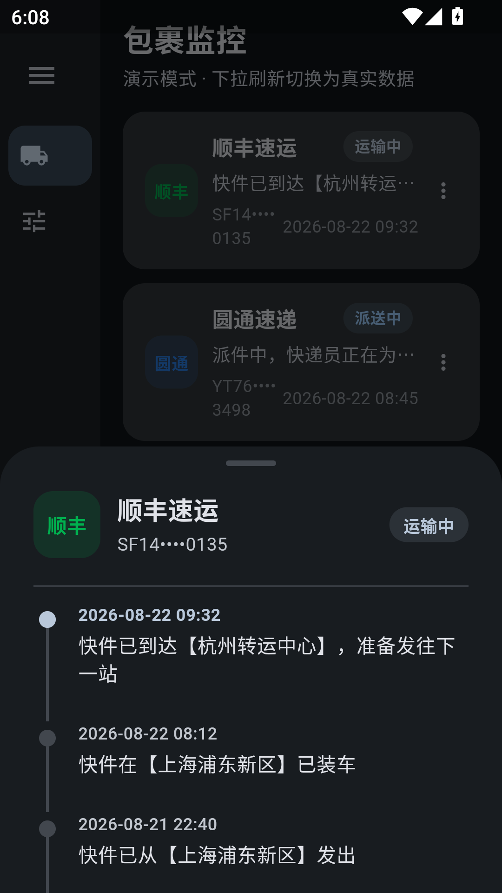
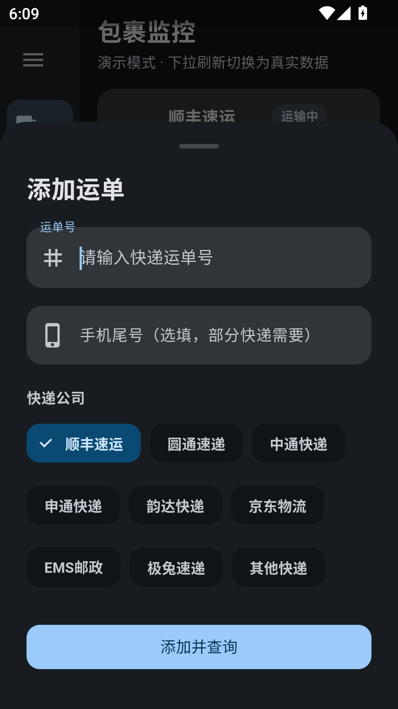

<p align="center">English | <a href="README.zh-CN.md">简体中文</a></p>

# Package Monitor (包裹监控)

Parcel tracking for Windows desktop and Android: add a courier tracking number, the app keeps the logistics timeline fresh and pops a tray notification when something new happens. Ad-free, no account, all data stays on your device.

**Architecture** — [two-edition architecture](docs/architecture.html): interactive, self-contained HTML.

## 1. Install

Download from [**Releases**](https://github.com/Shifu-HU/package-monitor/releases/latest):

| Platform | File | Size | How to install |
|---|---|---|---|
| Windows 10/11 | [`PackageMonitor.exe`](https://github.com/Shifu-HU/package-monitor/releases/latest/download/PackageMonitor.exe) | ~210 MB | Single file — double-click to run. No Python, no installation, no dependencies. |
| Android | [`PackageMonitor.apk`](https://github.com/Shifu-HU/package-monitor/releases/latest/download/PackageMonitor.apk) | ~21 MB | Install directly on the phone. No app store, no account. |

- The builds are **unsigned**: Windows may show a SmartScreen warning → *More info* → *Run anyway*; some browsers warn about APKs → install anyway.
- The apps **contain no credentials** — you enter your own on first launch, or start with Demo mode.
- Antivirus occasionally flags PyInstaller builds; add a trust rule if that happens.

## 2. Pick a data provider (first launch)

The app queries logistics through a "provider". Pick one on the desktop login window / Android welcome screen:

| Provider | Credentials needed | Notes |
|---|---|---|
| **Kuaidi100 API** (recommended) | customer (enterprise ID) + key (auth key) | Reliable per-number realtime query |
| KDNiao API | EBusinessID + AppKey | Alternative per-number query |
| Cainiao account | phone number (SMS login) | Legacy web API — supplementary only, may break at any time |
| Demo mode | none | Built-in sample parcels, fully offline |

## 3. Get free API credentials (one-time)

### Kuaidi100 (recommended)

1. Sign up at **<https://api.kuaidi100.com/>** (phone number is enough);
2. Complete **identity verification** (personal verification works, usually instant);
3. In the console, activate the "**Realtime Express Query**" service (free trial quota included);
4. Copy the two credentials from the console:
   - **customer** (enterprise ID / auth code)
   - **key** (auth key)
5. Enter them in the desktop login window / Android welcome screen.

- Official realtime-query docs: <https://api.kuaidi100.com/document/5f0ffb5ebc8da837cbd8aefc.html>
- Desktop only: with no key set, the app falls back to a "free public query" (some couriers need the phone tail).

### KDNiao

1. Sign up at **<https://www.kdniao.com/>**;
2. User Center → **Real-name Verification** (free);
3. Service Center → activate "**Logistics Tracking (instant query)**" (free tier has a daily query cap);
4. User Center → Key Management → copy **EBusinessID** + **AppKey**;
5. Enter them in the app.

## 4. Add & track parcels

### Windows desktop

1. Launch → pick a provider → enter credentials (or pick Demo mode);
2. "＋" → paste a tracking number → pick the courier → add;
3. Cards auto-refresh every 5 minutes; new events pop a **system-tray notification**;
4. Click a card for the full timeline (newest first); the app keeps running in the tray on close.

### Android

1. Install the APK → pick a provider on the welcome screen;
2. "＋" FAB → tracking number → courier chip → add & query;
3. Auto-refresh every 5 minutes (adjustable in Settings); pull down for an instant refresh;
4. Tap a card — the timeline slides up as a half-screen sheet; foldables adapt automatically.

Supported couriers: SF / YTO / ZTO / STO / YUNDA / JD / EMS / J&T / Other. Couriers that need it (e.g. SF) accept optional phone-tail digits.

| Welcome | Home | Half-screen details | Add shipment |
| --- | --- | --- | --- |
|  |  |  |  |

## 5. Settings

| Setting | Where | What it does |
|---|---|---|
| Refresh interval | Both editions | Default 5 min; pull-to-refresh resets the timer |
| Do-not-disturb | Both editions | Silences notifications, keeps refreshing |
| Appearance | Desktop | Dark / light / follow system, 8 built-in color schemes |
| Data source notes / logs | Desktop | Provider notes and query logs |
| Clear my info | Desktop | Wipes cookies / API keys from `%APPDATA%\CainiaoMonitor\` |

Desktop extras: single instance, staggered card grid, embedded browser (full edition) for Cainiao web login — the lite edition logs in via "system browser + paste Cookie".

## 6. Troubleshooting

| Symptom | Cause / fix |
|---|---|
| Windows blocks the exe | SmartScreen on unsigned builds → *More info* → *Run anyway* |
| Query fails | The card keeps showing cached data; check your key quota / network, then retry |
| Kuaidi100 / KDNiao quota error | Free tier daily cap — resets daily, upgrade to paid, or switch provider |
| SF query comes back empty | Add the receiver's phone-tail digits when adding the parcel |
| Cainiao login broken | Legacy web API — use Kuaidi100 / KDNiao instead |
| Emulator can't resolve API hosts | The Android app already falls back to IP + Host header |

## 7. Build from source

### Windows desktop (Python 3.10+)

```bat
git clone https://github.com/Shifu-HU/package-monitor.git
cd package-monitor
pip install -r requirements.txt
python main.py --simulate   # demo mode, no account needed
python main.py              # pick a provider on the login window
```

Package a standalone exe (onedir build — zero unpacking at runtime, avoids MSVCP140 extraction errors):

```bat
pip install -r requirements-dev.txt
python tools\gen_icon.py
pyinstaller --clean --noconfirm --distpath dist_lite --workpath build_lite cainiao_monitor_lite_onedir.spec
```

Output: `dist_lite\CainiaoMonitorLite\`. Full edition (embedded Cainiao browser): `build_full.bat` / `cainiao_monitor_full_onedir.spec`; lite edition: `build_lite.bat`.

### Android (Flutter 3.24.x / Dart 3.5.x, Android SDK 34)

```bash
git clone https://github.com/Shifu-HU/package-monitor.git
cd package-monitor/flutter_app
flutter config --android-sdk <path-to-your-sdk>   # prevents local.properties from being overwritten
flutter pub get
flutter build apk --release
# Output: build/app/outputs/flutter-apk/app-release.apk
```

## 8. Privacy & data

- All credentials, cookies and caches stay in `%APPDATA%\CainiaoMonitor\` (desktop) / app-private storage (Android) — nothing is uploaded;
- Before sharing your machine's data: Settings → "**Clear my info**", or delete the `%APPDATA%\CainiaoMonitor` folder manually;
- Personal project, not affiliated with Alibaba / Cainiao / Kuaidi100 / KDNiao or any other company; APIs may change at any time; use at your own risk.
