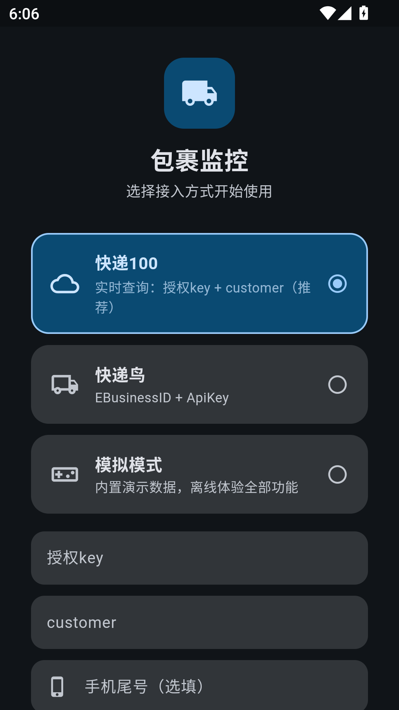
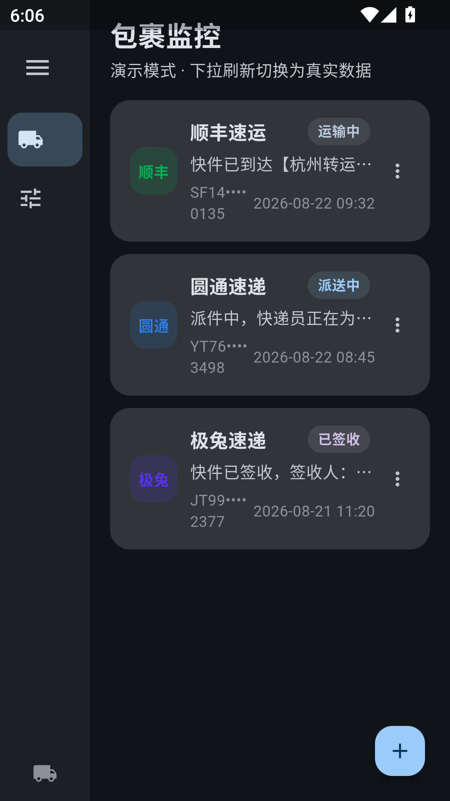
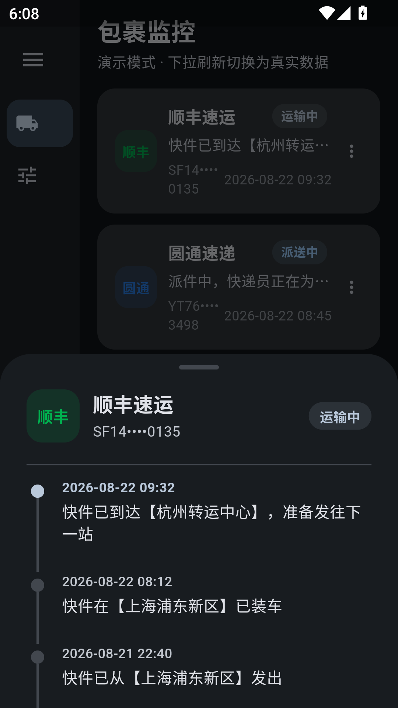
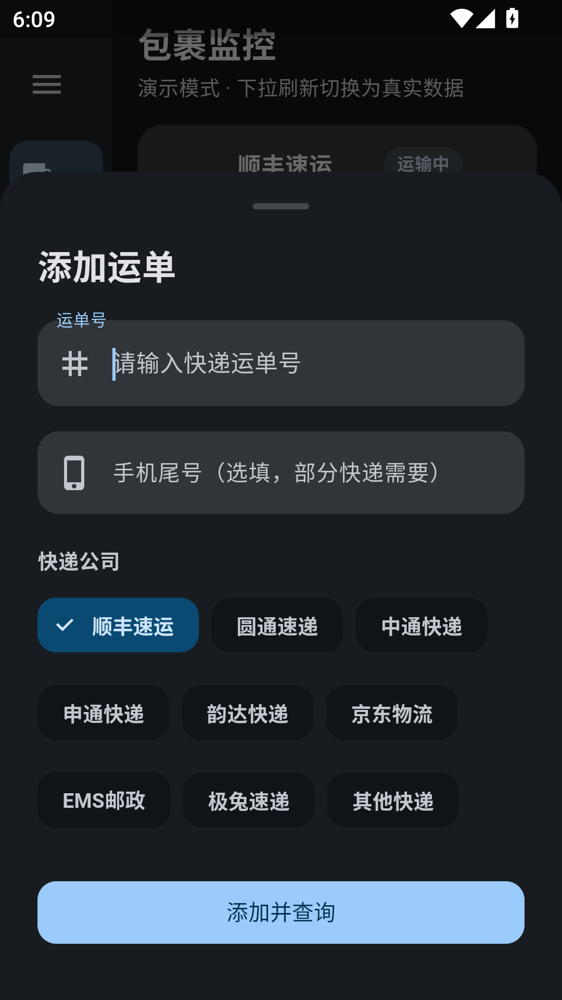

<p align="center"><a href="README.md">English</a> | 简体中文</p>

# 包裹监控（Package Monitor）

Windows 桌面 + Android 双端快递物流追踪：添加运单号后自动保持轨迹最新，有新动态弹托盘通知。无广告、免账号，所有数据只保存在本机。

**架构图** —— [双端项目架构](docs/architecture.zh-CN.html) · [仓库归集与署名统一流程](docs/git-ops.zh-CN.html)：可交互，单文件 HTML。

## 1. 安装

从 [**Releases**](https://github.com/Shifu-HU/package-monitor/releases/latest) 下载：

| 平台 | 文件 | 大小 | 安装方式 |
|---|---|---|---|
| Windows 10/11 | [`PackageMonitor.exe`](https://github.com/Shifu-HU/package-monitor/releases/latest/download/PackageMonitor.exe) | 约 210 MB | 单文件，双击即用。无需 Python、无需安装、无依赖。 |
| Android | [`PackageMonitor.apk`](https://github.com/Shifu-HU/package-monitor/releases/latest/download/PackageMonitor.apk) | 约 21 MB | 直接装到手机上。免应用商店、免账号。 |

- 安装包**未签名**：Windows 可能弹 SmartScreen 警告 → 「更多信息」→「仍要运行」；部分浏览器会提示 APK 风险 → 照常安装即可。
- 应用内**不含任何凭证**——首次启动填入自己的，或先玩模拟模式。
- 杀毒软件偶尔会误报 PyInstaller 打包的程序，加一条信任规则即可。

## 2. 选择数据服务商（首次启动）

应用通过「服务商」查询物流，在桌面登录窗口 / Android 欢迎页三选一：

| 服务商 | 所需凭证 | 说明 |
|---|---|---|
| **快递100 API**（推荐） | customer（企业ID）+ key（授权key） | 按单号实时查询，稳定可靠 |
| 快递鸟 API | EBusinessID + AppKey | 按单号查询的备选 |
| 菜鸟账号 | 手机号（短信登录） | 走老版 Web 接口——仅作补充，随时可能失效 |
| 模拟模式 | 无 | 内置示例包裹，完全离线 |

## 3. 免费申请 API 凭证（一次性）

### 快递100（推荐）

1. 在 **<https://api.kuaidi100.com/>** 注册登录（手机号即可）；
2. 完成**实名认证**（个人认证即可，一般即时通过）；
3. 控制台开通「**实时快递查询**」服务（含免费试用额度）;
4. 在控制台复制两样凭证：
   - **customer**（企业ID / 授权码）
   - **key**（授权 key）
5. 填入桌面登录窗口 / Android 欢迎页。

- 官方实时查询文档：<https://api.kuaidi100.com/document/5f0ffb5ebc8da837cbd8aefc.html>
- 仅桌面版：不填 key 时会回落到「免费公共查询」（部分快递需要手机尾号）。

### 快递鸟

1. 在 **<https://www.kdniao.com/>** 注册登录；
2. 用户中心 → **实名认证**（免费）；
3. 服务中心 → 开通「**物流查询（即时查询）**」API（免费档每日有查询上限）；
4. 用户中心 → 我的信息 / Key 管理 → 复制 **EBusinessID** + **AppKey**；
5. 填入应用即可。

## 4. 添加与追踪包裹

### Windows 桌面版

1. 启动 → 选服务商 → 填凭证（或选模拟模式）；
2. 「＋」→ 粘贴运单号 → 选快递公司 → 添加；
3. 卡片每 5 分钟自动刷新，有新动态弹**系统托盘通知**；
4. 点卡片看完整轨迹（最新在前）；关闭窗口程序驻留托盘。

### Android 版

1. 安装 APK → 欢迎页选服务商；
2. 「＋」悬浮按钮 → 输入运单号 → 选快递公司芯片 → 添加并查询；
3. 每 5 分钟自动刷新（设置里可调），下拉立即刷新；
4. 点卡片，轨迹以恒定半屏弹层从底部滑入，折叠屏自动适配。

支持快递：顺丰 / 圆通 / 中通 / 申通 / 韵达 / 京东 / EMS / 极兔 / 其他。部分快递（如顺丰）可填手机尾号后几位。

| 欢迎页 | 首页 | 详情半屏 | 添加运单 |
| --- | --- | --- | --- |
|  |  |  |  |

## 5. 设置

| 设置项 | 位置 | 作用 |
|---|---|---|
| 刷新间隔 | 双端 | 默认 5 分钟；下拉刷新会重置计时 |
| 免打扰 | 双端 | 静音通知，刷新照常 |
| 外观 | 桌面版 | 深 / 浅 / 跟随系统，8 套内置配色 |
| 数据源说明 / 日志 | 桌面版 | 服务商说明与查询日志 |
| 清除我的信息 | 桌面版 | 清掉 `%APPDATA%\CainiaoMonitor\` 里的 Cookie / API key |

桌面版还有：单实例运行、瀑布流卡片栅格、完整版内置浏览器菜鸟网页登录——精简版走「系统浏览器登录 + 粘贴 Cookie」。

## 6. 常见问题

| 现象 | 原因 / 处理 |
|---|---|
| Windows 拦截 exe | 未签名的 SmartScreen 警告 → 「更多信息」→「仍要运行」 |
| 查询失败 | 卡片继续显示缓存数据；检查 key 额度 / 网络后重试 |
| 快递100 / 快递鸟额度报错 | 免费档每日上限——次日重置、升级付费或换服务商 |
| 顺丰查询为空 | 添加运单时填上收件人手机尾号 |
| 菜鸟登录失效 | 老版 Web 接口——改用快递100 / 快递鸟 |
| 模拟器解析不了 API 域名 | Android 版已内置 IP + Host 头兜底 |

## 7. 从源码构建

### Windows 桌面版（Python 3.10+）

```bat
git clone https://github.com/Shifu-HU/package-monitor.git
cd package-monitor
pip install -r requirements.txt
python main.py --simulate   # 模拟模式，无需账号
python main.py              # 登录窗口选服务商
```

打包独立 exe（onedir 构建——运行时零解压，避开 MSVCP140 解压报错）：

```bat
pip install -r requirements-dev.txt
python tools\gen_icon.py
pyinstaller --clean --noconfirm --distpath dist_lite --workpath build_lite cainiao_monitor_lite_onedir.spec
```

产物：`dist_lite\CainiaoMonitorLite\`。完整版（内置菜鸟浏览器）：`build_full.bat` / `cainiao_monitor_full_onedir.spec`；精简版：`build_lite.bat`。

### Android 版（Flutter 3.24.x / Dart 3.5.x，Android SDK 34）

```bash
git clone https://github.com/Shifu-HU/package-monitor.git
cd package-monitor/flutter_app
flutter config --android-sdk <你的SDK路径>   # 防止 local.properties 被覆写
flutter pub get
flutter build apk --release
# 产物：build/app/outputs/flutter-apk/app-release.apk
```

## 8. 隐私与数据

- 所有凭证、Cookie、缓存只存在 `%APPDATA%\CainiaoMonitor\`（桌面版）/ 应用私有目录（Android 版），什么都不上传；
- 分享机器数据前：设置 → 「**清除我的信息**」，或手动删除 `%APPDATA%\CainiaoMonitor` 文件夹；
- 个人项目，与阿里巴巴 / 菜鸟 / 快递100 / 快递鸟等任何公司无关；接口随时可能变动，使用风险自担。
